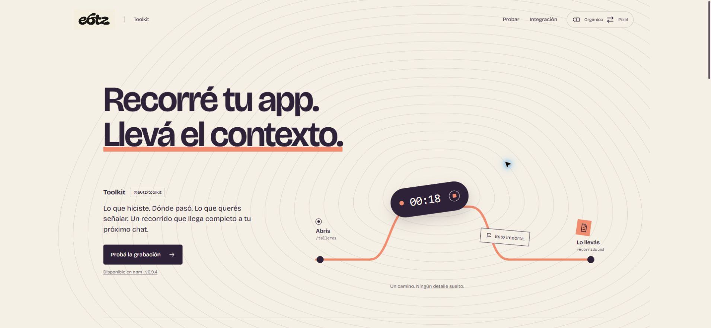

# Toolkit

[Website](https://toolkit.6tz.tech) · [npm: @e6tz/toolkit](https://www.npmjs.com/package/@e6tz/toolkit) · [MIT](LICENSE)

[](https://toolkit.6tz.tech)

Record a walkthrough, mark what matters, and take the context to your next chat.

`@e6tz/toolkit` is a standalone React and Next.js package. Version **0.9.4** is available on npm with its documented public entrypoints. Toolkit is licensed under [MIT](LICENSE).

## Install

Requires Node.js 20.9+ and React / React DOM 18.3 or 19.

Install the public package from npm:

```sh
npm install @e6tz/toolkit
```

Alternatively, install from this GitHub repository:

```sh
npm install git+https://github.com/Enry6tz/Toolkit.git
```

The Git install runs `prepare` to compile the package. To build a local tarball instead:

```sh
git clone https://github.com/Enry6tz/Toolkit.git
cd Toolkit
npm install
npm pack
```

Then, from your application, install the actual generated file:

```sh
npm install /actual/path/to/e6tz-toolkit-0.9.4.tgz
```

The package metadata permits public scoped publication. Neither building, packing nor the CI workflow publishes a release.

## React

Mount the toolbar once near the application root so client-side navigation keeps the recorder alive:

```tsx
import { AIToolbar } from '@e6tz/toolkit/react';

export function App() {
  return (
    <>
      <YourApplication />
      <AIToolbar environment="development" locale="es" />
    </>
  );
}
```

Use `environment="preview"` for a preview deployment. Production is off by default and requires explicit opt-in. The toolbar isolates its interface with Shadow DOM.

## Next.js

The server adapter derives the environment and passes serializable options to the client toolbar:

```tsx
import { AIToolbar } from '@e6tz/toolkit/next';

export default function RootLayout({ children }) {
  return (
    <html lang="es">
      <body>
        {children}
        <AIToolbar />
      </body>
    </html>
  );
}
```

The adapter does not require a platform backend. React and React DOM are peer dependencies; this package does not depend on a local workspace or another project.

## What it records

Start a recording, walk through your application, add marks and comments, stop, then copy the context. A recording contains ordered steps, routes, observations and optional network context. A selected step is a view of the recording; it does not replay business actions or restore historical application state.

Network recording is an explicit preference and observes fetch activity only while recording. Resource aliases and bounded request/response previews are configured by the integrator. Omitted or truncated detail remains explicit; review the result before sharing it. The visible workflow does not record video, request screen sharing or create continuous screenshots.

Markdown and JSON exporters are available from `@e6tz/toolkit/review`. Project documents can be explicitly bundled through `@e6tz/toolkit/config`; all documents shipped to the client are public to recipients of those assets. Optional wiki and live-configuration integrations are configuration-driven, not prerequisites.

The package includes no AI model, account system, login form or automatic message sending. The conversation and the decision about what to do next belong in your own chat.

## Integrate with a host application

Toolkit, Reports and Flags are independent libraries, not complete hosted applications. They share host-owned authentication, authorization, backend routes and secrets, but have different interfaces.

Toolkit works locally without a backend. With no `wiki`, `liveConfig`, `loadKnowledge`, document-editor `onSave` or `documentsPath`, it makes no integration requests and invents no server route. Local recording, annotations, document copying and Markdown/JSON export do not require login. The bundled font is a package-local asset.

Enable each remote integration explicitly by supplying its URL or callback. A separate master remote flag is not required. Without `documentsPath`, bundled documents have a label and copy action, not a link to an assumed editor. Mount your own editor route before setting this option.

The host owns login and permission enforcement. Toolkit has no embedded login iframe or credential issuance, renewal or storage. Configured wiki requests retain session cookies and CSRF protection; the host must authorize every read and mutation. A hidden or disabled client control is not a security boundary.

See the [backend implementation guide](docs/backend-integration.md) for wire contracts, reference storage records and acceptance checks, or the [website documentation](https://toolkit.6tz.tech/docs/).

See the [host integration guide](docs/host-integration.md) for React/Next examples, authentication refresh and teardown. The lifecycle guide is included in the published npm package; the newer backend guide is available in this repository and on the website without republishing that version. A combined self-hosted host application is not supplied by this repository.

## Entrypoints

| Import | Purpose |
| --- | --- |
| `@e6tz/toolkit` / `/react` | Toolbar and React document editor |
| `/next` | Server adapter for Next.js |
| `/core` | Types, privacy, documents and context normalization |
| `/browser` | Browser observation and read-only context integration |
| `/review` | Recording state, persistence and exports |
| `/config` | Node-side configuration and document bundling |

Legacy programmatic case/capture APIs remain part of the source for compatibility. They do not define the visible recording workflow.

## Development and verification

```sh
npm ci
npx --no-install playwright install chromium
npm run typecheck
npm test
npm run check:package
```

`test:node` runs the existing standalone SDK tests, including browser-backed tests. They need Chromium from the matching Playwright version; if absent, provision it in your environment with `npx playwright install chromium`. `test:unit` runs the isolated navigation, persistence, dock, network-policy and recording-quality tests from the current source. Fixtures are synthetic and do not need an account, database, platform, `.env` file or existing application server.

CI runs these checks on Node.js 22 and 24, including Linux Chromium dependencies. `check:package` builds a real tarball and installs it into an independent temporary consumer, then checks all seven imports, declarations, React/Next server rendering, recording behavior, browser isolation and bundled font notices. It reports the retained temporary directory for inspection and cleanup; it never publishes or needs registry credentials. Use Node.js 22.12+ or 24+ for development; the runtime engine range remains unchanged.

The build copies the bundled Cascadia Code font and its original license notices into `dist`. Generated output, tarballs, dependency folders and local artifacts are ignored by Git.

See [the architecture](docs/architecture.md) for the package boundaries. Toolkit is licensed under [MIT](LICENSE). Bundled fonts retain their original licenses and notices in `src/react/assets` and the distributed assets.
